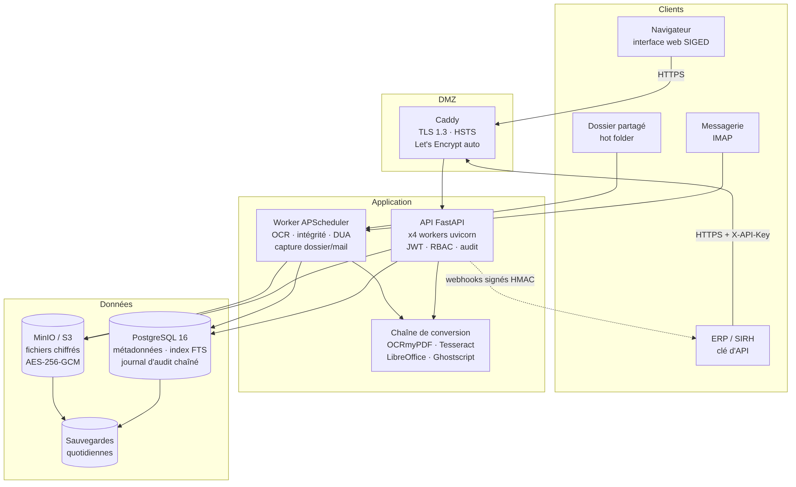
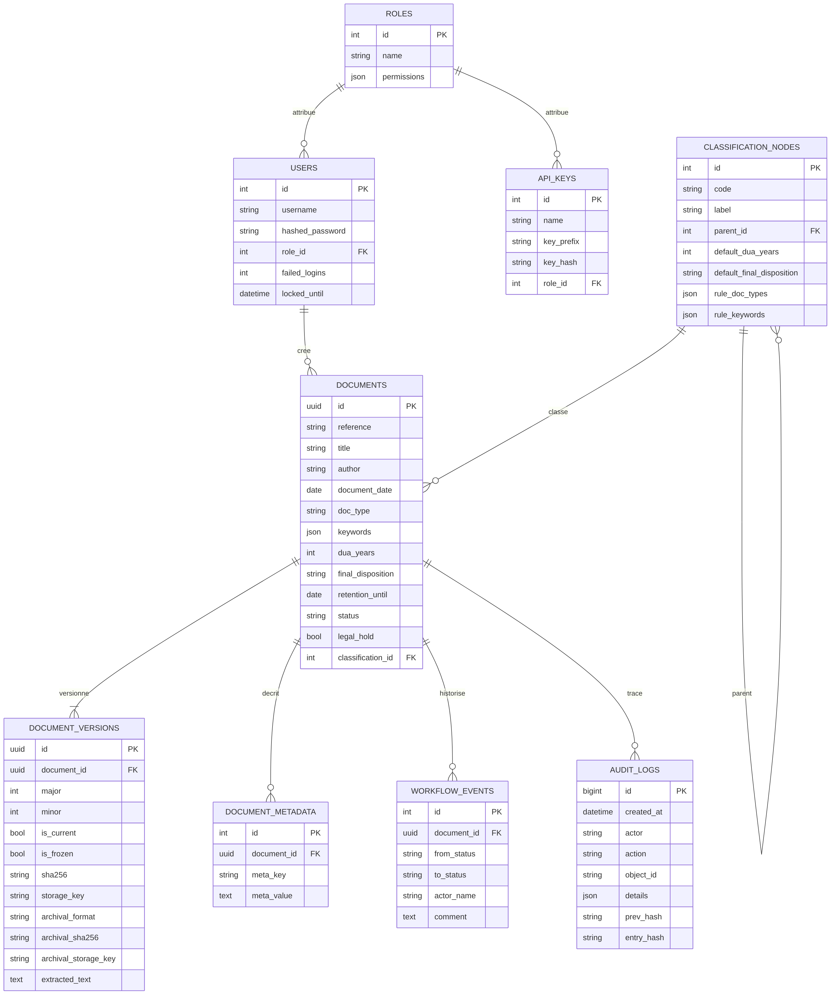
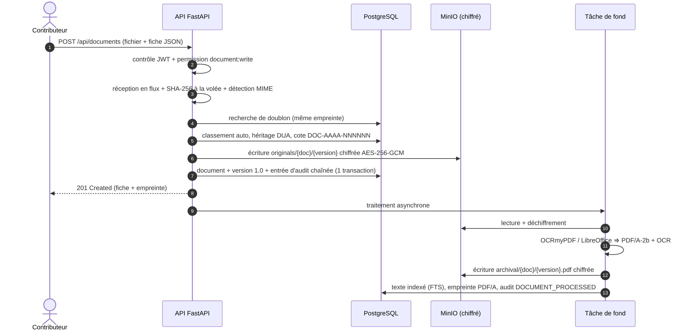
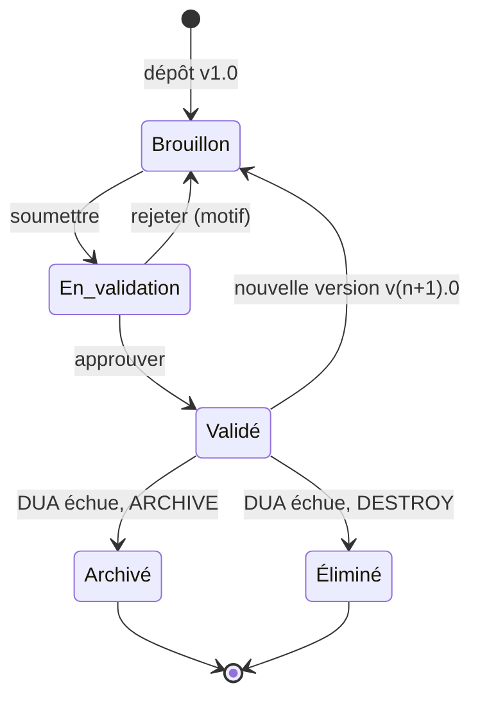
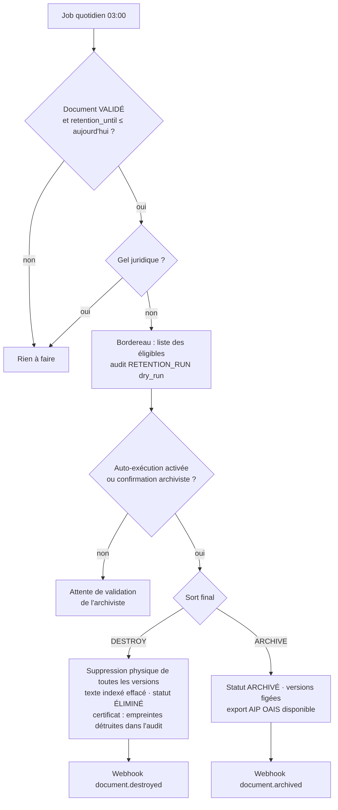

# 1. Objet du document

Ce cahier décrit l'architecture logicielle, technique et de sécurité de **SIGED**, la plateforme de gestion électronique des documents (GED) et de système d'archivage électronique (SAE) réalisée en réponse au cahier des charges. Il justifie les choix techniques, présente les vues logique, physique et données, et montre comment chaque exigence est satisfaite.

**Public visé** : jury, maîtrise d'ouvrage, équipe de développement, exploitants.

**Documents associés** : rapports de sprint (`docs/rapports/`), contrat d'API OpenAPI (`docs/openapi.json`, consultable en ligne sur `/docs`), guide d'installation (`README.md`).

# 2. Rappel des exigences

| Réf. | Domaine | Exigence |
|---|---|---|
| EX-01 | Objectifs | Centralisation dans un système unique, sans dispersion ni doublons |
| EX-02 | Objectifs | Recherche optimisée par métadonnées structurées |
| EX-03 | Objectifs | Sécurité et traçabilité du cycle de vie |
| EX-04 | Objectifs | Interopérabilité avec ERP, SIRH, messagerie |
| EX-05 | Acquisition | Téléversement manuel, import par lot, capture automatique (API / dossiers partagés) |
| EX-06 | Acquisition | Conversion au format pérenne PDF/A + OCR |
| EX-07 | Acquisition | Fiche de métadonnées obligatoire (titre, auteur, date, type, mots-clés, DUA) |
| EX-08 | Acquisition | Plan de classement normé, classement automatique ou manuel |
| EX-09 | Métier | Recherche multicritère + plein texte |
| EX-10 | Métier | Prévisualisation sans téléchargement |
| EX-11 | Métier | Gestion des versions (v1.0, v1.1…) sans écraser l'historique |
| EX-12 | Métier | Circuit de validation (brouillon, en validation, validé) |
| EX-13 | Architecture | Stockage hybride : métadonnées en base SQL, fichiers en Object Storage |
| EX-14 | Architecture | Empreinte SHA-256 au dépôt (preuve de non-altération) |
| EX-15 | Sécurité | RBAC (lecture, écriture, administration) |
| EX-16 | Sécurité | Chiffrement TLS 1.3 en transit, AES-256 au repos |
| EX-17 | Normes | Principes ISO 15489 et ISO 14721 (OAIS) |
| EX-18 | Normes | Gestion automatisée de la DUA et du sort final |
| EX-19 | Normes | Journal d'audit inaltérable (consultations, modifications, suppressions) |
| EX-20 | Performance | Réponse < 2 s, disponibilité 99,9 %, sauvegardes quotidiennes |

# 3. Choix techniques et justifications

## 3.1 Pile retenue

| Couche | Technologie | Version |
|---|---|---|
| API | Python 3.12 + **FastAPI** + Uvicorn | FastAPI 0.143 |
| Accès aux données | SQLAlchemy 2 (ORM), psycopg 3 | 2.1 |
| Base de données | **PostgreSQL 16** (+ extension `pg_trgm`) ; SQLite en développement | 16 |
| Stockage des fichiers | **MinIO** (compatible S3) ou système de fichiers | — |
| Chiffrement | `cryptography` : AES-256-GCM ; bcrypt ; JWT HS256 (PyJWT) | — |
| Conversion / OCR | **OCRmyPDF** + Tesseract (fra, eng) + Ghostscript ; **LibreOffice** headless ; pypdf, pypdfium2 | OCRmyPDF 17 |
| Tâches planifiées | APScheduler (processus *worker* séparé) | 3.11 |
| Frontal | Caddy (HTTPS automatique Let's Encrypt, TLS 1.3) | 2.10 |
| Interface web | HTML/CSS/JavaScript natif servi par l'API | — |
| Déploiement | Docker Compose ; CI GitHub Actions | — |

## 3.2 Décisions d'architecture (ADR)

**ADR-01 — FastAPI plutôt que NestJS.** Le cœur de valeur de la GED est le traitement documentaire (OCR, PDF/A, extraction de texte, rendu d'aperçus). L'écosystème Python couvre ces besoins nativement (OCRmyPDF, pypdf, pytesseract, pypdfium2) sans pont inter-langages. FastAPI apporte la validation par Pydantic, la documentation OpenAPI générée automatiquement (contrat d'interopérabilité EX-04) et de bonnes performances. La robustesse du workflow, argument de NestJS, est obtenue par une machine à états explicite et testée (`services/workflow.py`).

**ADR-02 — Recherche plein texte PostgreSQL plutôt qu'OpenSearch (pour la V1).** L'index GIN sur `to_tsvector('french', texte)` couvre la recherche plein texte avec racinisation française, classement (`ts_rank`) et extraits surlignés (`ts_headline`). Il évite un composant supplémentaire à exploiter et à sécuriser, et garantit la cohérence transactionnelle entre métadonnées et index. Mesure : 2 000 notices avec texte → recherche plein texte en 0,44 s, recherche par critères en moins de 50 ms (cf. §10). Le service `services/search.py` isole la recherche : si le volume dépasse plusieurs centaines de milliers de documents, un connecteur OpenSearch pourra le remplacer sans toucher à l'API.

**ADR-03 — Chiffrement applicatif AES-256-GCM avant stockage.** Plutôt que de dépendre uniquement du chiffrement côté serveur de MinIO (qui exige un KMS), l'application chiffre chaque fichier **avant** de l'écrire. Le stockage (MinIO, S3 public, NAS) ne voit jamais de données en clair : une fuite de sauvegarde ou du bucket ne révèle rien. Le mode GCM authentifie aussi le contenu : toute altération est détectée au déchiffrement, ce qui complète le contrôle SHA-256.

**ADR-04 — OCRmyPDF plutôt qu'Apache Tika.** OCRmyPDF produit directement un **PDF/A-2b** avec couche texte OCR (exigence EX-06), là où Tika ne fait qu'extraire du texte et impose une JVM. LibreOffice headless convertit les formats bureautiques en PDF/A-2b. La chaîne se dégrade proprement si un outil manque (statut `PARTIAL`, journal de conversion).

**ADR-05 — Journal d'audit chaîné par empreintes.** Chaque entrée contient l'empreinte de la précédente (`prev_hash`) et sa propre empreinte (`entry_hash`) : c'est le principe d'une chaîne de blocs, sans sa complexité. Deux protections se combinent : en PostgreSQL, des déclencheurs interdisent `UPDATE`, `DELETE` et `TRUNCATE` ; et si un administrateur de base contourne ces déclencheurs, la vérification de la chaîne révèle l'altération.

**ADR-06 — Traitements lourds hors du chemin de la requête.** Le dépôt répond dès que le fichier est haché, chiffré et enregistré ; la conversion PDF/A et l'OCR sont exécutés en tâche de fond. Cela tient l'objectif < 2 s même pour un scan de 50 pages. Un job nocturne reprend les conversions restées en attente ou en échec.

# 4. Vue d'ensemble



Le système suit une **architecture en couches** déployée en conteneurs :

* **Frontal (DMZ)** — Caddy termine le TLS 1.3, obtient et renouvelle automatiquement le certificat Let's Encrypt, impose HSTS et la politique de sécurité du contenu (CSP), et limite la taille des téléversements (200 Mo).
* **Application** — l'API FastAPI (4 workers) porte la logique métier et l'interface web ; le *worker* exécute les tâches planifiées et les captures automatiques. Les deux partagent le même code et la même configuration.
* **Données** — PostgreSQL contient métadonnées, index, droits et traces ; MinIO contient les fichiers chiffrés. Les deux sont sauvegardés chaque jour.

# 5. Vue logique

## 5.1 Découpage en modules

```
backend/app/
├── main.py                  Application FastAPI, middlewares (temps de réponse, en-têtes de sécurité)
├── core/
│   ├── config.py            Configuration par variables d'environnement (SIGED_*)
│   ├── database.py          Moteur SQLAlchemy, création du schéma + objets PostgreSQL
│   ├── security.py          bcrypt, JWT, clés d'API, permissions et rôles
│   ├── crypto.py            Chiffrement AES-256-GCM par blocs (flux)
│   └── deps.py              Identification (JWT / X-API-Key) et contrôle RBAC
├── models.py                Modèle de données (11 tables)
├── schemas.py               Contrats d'entrée/sortie (Pydantic)
├── api/                     Couche présentation REST (48 opérations)
│   ├── auth.py  documents.py  search.py  classification.py  admin.py
├── services/                Couche métier
│   ├── documents.py         Acquisition, empreinte, versions, métadonnées, traitement
│   ├── conversion.py        PDF/A, OCR, extraction de texte
│   ├── storage.py           Stockage hybride (local / S3) + façade chiffrante
│   ├── classification.py    Plan de classement, classement automatique
│   ├── search.py            Recherche multicritère et plein texte
│   ├── workflow.py          Machine à états de validation
│   ├── retention.py         DUA, sort final, élimination, versement
│   ├── integrity.py         Contrôle périodique des empreintes
│   ├── audit.py             Journal chaîné inaltérable
│   ├── oais.py              Export de paquets AIP (ISO 14721)
│   ├── events.py            Webhooks signés, notifications e-mail
│   └── bootstrap.py         Rôles, administrateur, plan de classement initial
├── jobs/                    Processus worker
│   ├── scheduler.py  hot_folder.py  mail_ingest.py
└── static/                  Interface web (index.html, app.js, style.css)
```

**Règle de dépendance** : `api → services → (models, core)`. Les routes ne contiennent pas de logique métier ; les services ne dépendent pas de FastAPI (ils sont réutilisés tels quels par le worker, le hot folder et l'ingestion e-mail). Les erreurs métier sont levées sous forme de `BusinessError(message, code HTTP)` et traduites en réponses JSON par un gestionnaire unique.

## 5.2 Principales opérations d'API

| Domaine | Opérations |
|---|---|
| Authentification | `POST /api/auth/login`, `GET /api/auth/me`, `GET/POST/PATCH /api/users`, `GET /api/roles` |
| Documents | `POST /api/documents`, `POST /api/documents/batch`, `GET/PATCH/DELETE /api/documents/{id}` |
| Versions | `GET/POST /api/documents/{id}/versions`, `GET …/versions/{vid}/verify` |
| Consultation | `GET …/preview`, `GET …/preview/pages`, `GET …/preview/page/{n}`, `GET …/download` |
| Workflow | `POST …/submit`, `POST …/approve`, `POST …/reject`, `GET …/workflow` |
| Recherche | `GET /api/search` (13 critères, tri, pagination) |
| Classement | `GET/POST/PUT/DELETE /api/classification`, `POST /api/classification/suggest` |
| Conformité | `GET /api/audit`, `GET /api/audit/verify`, `POST /api/admin/integrity/run`, `GET /api/retention/due`, `POST /api/retention/run`, `PUT …/legal-hold`, `GET …/aip` |
| Interopérabilité | `GET/POST/DELETE /api/integrations/api-keys`, `…/webhooks`, `GET /api/integrations/events` |
| Supervision | `GET /health`, `GET /api/admin/stats` |

Le contrat complet est généré automatiquement (`/docs`, `/openapi.json`).

# 6. Modèle de données



| Table | Rôle |
|---|---|
| `documents` | Entité logique : fiche de métadonnées obligatoire, cote lisible `DOC-AAAA-NNNNNN`, statut, DUA, date de fin de conservation `retention_until`, gel juridique |
| `document_versions` | Une ligne par version : numéro majeur/mineur, empreintes SHA-256 de l'original **et** de la représentation PDF/A, clés de stockage, texte extrait/OCR, indicateur « figée » |
| `document_metadata` | Métadonnées dynamiques clé/valeur (n° de facture, matricule…) |
| `classification_nodes` | Plan de classement arborescent, DUA et sort final par défaut, règles de classement automatique |
| `workflow_events` | Historique des transitions du circuit de validation |
| `audit_logs` | Journal chaîné, en ajout seul |
| `users`, `roles`, `api_keys` | Identités et RBAC (les clés d'API ne sont stockées que sous forme d'empreinte) |
| `webhooks`, `integrity_checks`, `sequences` | Abonnements, rapports d'intégrité, compteurs de cotes |

**Index notables** : GIN plein texte français sur `document_versions.extracted_text` ; GIN trigrammes sur `title` et `author` (recherche floue) ; B-tree sur `status`, `doc_type`, `document_date`, `retention_until`, `(meta_key, meta_value)`, `audit_logs.object_id`.

**Choix** : `retention_until` est calculé et **stocké** (et non recalculé à la volée) pour que la sélection des documents échus soit une simple requête indexée, portable entre SGBD. Le 29 février est ramené au 28 pour les années non bissextiles.

# 7. Flux principaux

## 7.1 Dépôt d'un document



1. Le fichier est lu **en flux** par blocs de 1 Mo ; l'empreinte SHA-256 est calculée à la volée, avant toute transformation : elle prouve l'état du fichier tel qu'il a été reçu.
2. Le type MIME est déterminé par les « nombres magiques » du fichier, pas seulement par l'extension déclarée.
3. Un fichier dont l'empreinte existe déjà est refusé (409, avec la cote du document existant) sauf forçage explicite : **pas de doublons** (EX-01).
4. Le classement est manuel (id ou code) ou automatique ; la DUA et le sort final sont hérités de la rubrique s'ils ne sont pas saisis ; leur absence finale bloque le dépôt (EX-07).
5. Le fichier est chiffré et écrit dans le stockage ; la fiche, la version 1.0 et l'entrée d'audit sont enregistrées **dans une même transaction**.
6. En tâche de fond : conversion PDF/A-2b, OCR, extraction du texte, indexation ; si le document n'était pas classé, un second classement automatique est tenté sur le texte OCR.

## 7.2 Circuit de validation et versions



| Action | Statut source → cible | Permission | Règles |
|---|---|---|---|
| Soumettre | Brouillon → En validation | `document:write` | une version doit exister |
| Approuver | En validation → Validé | `document:validate` | l'auteur ne peut pas valider son propre document (séparation des tâches) ; la version devient **figée** |
| Rejeter | En validation → Brouillon | `document:validate` | motif obligatoire |
| Nouvelle version | Brouillon : v1.0 → v1.1 (ou v2.0 si majeure) | `document:write` | refusée en validation, sur un document clos ou gelé, ou si le fichier est identique |
| Nouvelle version d'un document validé | Validé → Brouillon, **v(n+1).0 forcée** | `document:write` | les versions validées restent figées et consultables |

Les métadonnées ne sont modifiables qu'en brouillon ; chaque modification est tracée avec l'ancienne et la nouvelle valeur.

## 7.3 DUA et sort final



Le job quotidien (03:00) établit le **bordereau** des documents validés dont la DUA est échue et qui ne sont pas sous gel juridique. Par défaut (`SIGED_RETENTION_AUTO_EXECUTE=false`), l'archiviste confirme l'exécution, conformément à la pratique archivistique (visa avant élimination) ; le mode entièrement automatique est disponible par configuration.

* **DESTROY** : suppression physique de toutes les versions (originaux et PDF/A) et du texte indexé ; la notice et la trace d'élimination (empreintes des fichiers détruits) sont conservées dans le journal et valent **certificat d'élimination**.
* **ARCHIVE** : statut « Archivé » définitif, toutes les versions figées, export AIP disponible.

# 8. Sécurité

## 8.1 Authentification

* Mots de passe hachés par **bcrypt** (coût 12) ; politique : 10 caractères minimum, 3 classes de caractères sur 4.
* **Verrouillage** du compte 15 minutes après 5 échecs (protection contre la force brute).
* Jetons **JWT** HS256 de 30 minutes (identifiant unique `jti`) ; l'état du compte est revérifié à chaque requête (un compte désactivé perd l'accès immédiatement).
* **Clés d'API** pour les applications : 256 bits d'aléa, affichées une seule fois, stockées sous forme d'empreinte SHA-256, révocables, jamais de rôle administrateur.

## 8.2 Contrôle d'accès (RBAC)

| Permission | admin | archiviste | validateur | contributeur | lecteur |
|---|:-:|:-:|:-:|:-:|:-:|
| `document:read` | ✔ | ✔ | ✔ | ✔ | ✔ |
| `document:write` | ✔ | ✔ | | ✔ | |
| `document:validate` | ✔ | | ✔ | | |
| `document:delete` (brouillons) | ✔ | | | | |
| `classification:manage` | ✔ | ✔ | | | |
| `retention:manage` (DUA, gel, AIP) | ✔ | ✔ | | | |
| `audit:read` | ✔ | ✔ | | | |
| `admin:jobs` (intégrité) | ✔ | ✔ | | | |
| `user:manage` | ✔ | | | | |
| `integration:manage` | ✔ | | | | |

Les permissions sont vérifiées côté serveur par une dépendance FastAPI (`require(...)`) sur chaque route ; l'interface masque simplement ce que l'utilisateur ne peut pas faire.

## 8.3 Chiffrement

* **En transit** : TLS 1.3 exclusivement (`protocols tls1.3`), HSTS 2 ans, certificat Let's Encrypt renouvelé automatiquement par Caddy.
* **Au repos** : AES-256-GCM par blocs de 1 Mo. Chaque bloc a un nonce unique (préfixe aléatoire de 64 bits + compteur) et des données associées (index du bloc + drapeau « dernier bloc ») : un bloc modifié, retiré, permuté ou une troncature sont détectés. La clé (32 octets) est fournie par variable d'environnement et **doit être sauvegardée hors du serveur** ; l'application refuse de démarrer en production sans elle.
* Les téléchargements et aperçus sont déchiffrés **en flux** : le fichier en clair n'est jamais écrit sur disque côté serveur (hors répertoire temporaire de conversion, supprimé aussitôt).

## 8.4 Analyse des menaces (STRIDE simplifiée)

| Menace | Exemple | Contre-mesure |
|---|---|---|
| Usurpation | Vol de mot de passe, force brute | bcrypt, verrouillage, limitation de débit, JWT courts |
| Altération | Modification d'un fichier stocké | SHA-256 au dépôt + contrôle nocturne + authentification GCM |
| Répudiation | « Je n'ai pas supprimé ce document » | Journal chaîné inaltérable avec acteur, IP, agent utilisateur |
| Divulgation | Vol du bucket ou d'une sauvegarde | Chiffrement applicatif AES-256 ; clé hors stockage |
| Déni de service | Fichiers géants | Taille maximale (200 Mo), traitements asynchrones, workers multiples |
| Élévation de privilèges | Contributeur qui valide | RBAC serveur, séparation des tâches, clés d'API sans rôle admin |
| Injection / XSS | Texte OCR contenant du HTML | Requêtes paramétrées (ORM), échappement systématique côté client, CSP, `nosniff` |
| Traversée de chemin | Nom de fichier `../../etc/passwd` | Noms normalisés, clés de stockage générées (UUID), contrôle de racine |

# 9. Conformité normative

## 9.1 ISO 15489 (gestion des documents d'activité)

| Caractéristique ISO 15489 | Mise en œuvre |
|---|---|
| **Authenticité** | Identification de l'auteur, horodatage, piste d'audit complète |
| **Fiabilité** | Fiche de métadonnées obligatoire, circuit de validation, séparation des tâches |
| **Intégrité** | Empreintes SHA-256, versions figées après validation, chiffrement authentifié, journal inaltérable |
| **Exploitabilité** | Plan de classement, recherche multicritère et plein texte, format pérenne PDF/A, aperçu en ligne |
| Règles de conservation | DUA et sort final par rubrique, bordereau, élimination tracée, gel juridique |

## 9.2 ISO 14721 (modèle OAIS)

| Entité fonctionnelle OAIS | Composant SIGED |
|---|---|
| Entrées (*Ingest*) — SIP | Dépôt unitaire, lot ZIP + manifeste, hot folder, e-mail, API ; contrôle de doublon, empreinte |
| Stockage (*Archival Storage*) | Stockage chiffré, contrôle d'intégrité périodique, sauvegardes |
| Gestion des données (*Data Management*) | PostgreSQL : métadonnées descriptives, index |
| Administration | Rôles, plan de classement, supervision, rapports d'intégrité |
| Planification de la pérennisation | Migration systématique vers PDF/A-2b, conservation de l'original |
| Accès (*Access*) — DIP | Recherche, aperçu, téléchargement, **export AIP** |

Le **paquet AIP** exporté (`GET /api/documents/{id}/aip`) suit la structure BagIt (RFC 8493) : toutes les versions (original + PDF/A), un manifeste SHA-256, la description (`description.json`) et l'information de pérennisation (`pdi.json` : référence, contexte, intégrité, provenance tirée du journal d'audit).

# 10. Performance, disponibilité, sauvegardes

## 10.1 Temps de réponse (< 2 s)

| Mesure (2 000 notices avec texte, PostgreSQL 16) | Temps |
|---|---|
| Recherche plein texte (200 résultats, classement + extraits) | 442 ms |
| Critères type + date | 17 ms |
| Critère auteur + tri | 41 ms |
| Liste paginée sans critère | 33 ms |

Leviers : index GIN/trigrammes/B-tree, pagination obligatoire (100 résultats au plus par page), traitements lourds asynchrones, déchiffrement en flux, pool de connexions (10 + 20). Chaque réponse porte l'en-tête `X-Process-Time-ms` et toute requête de plus de 2 s est journalisée : l'exigence est **mesurée en continu**. Un test automatisé échoue si la recherche dépasse 2 s.

## 10.2 Disponibilité 99,9 % (≈ 8 h 45 d'arrêt par an au plus)

La composition Docker livrée cible un serveur unique (redémarrage automatique, sondes de santé). Pour l'objectif 99,9 %, l'architecture cible de production est la suivante :

* **API sans état** : au moins 2 instances derrière Caddy ou un répartiteur (Keepalived + adresse IP virtuelle) ; mise à jour progressive sans interruption.
* **PostgreSQL** en réplication en continu avec bascule automatique (Patroni ou équivalent) ; réplique en lecture pour les recherches lourdes.
* **MinIO distribué** (4 nœuds minimum, codage à effacement) : tolère la perte d'un nœud ou de disques.
* **Supervision** : sonde `/health` (base + stockage), alertes sur les requêtes lentes, échecs d'intégrité (webhook `integrity.failure`) et échecs de conversion.

## 10.3 Sauvegardes quotidiennes

* Conteneur `backup` : chaque nuit à 01:00, `pg_dump` (format personnalisé) + archive des objets MinIO (déjà chiffrés), fichier `SHA256SUMS`, rétention de 30 jours.
* Copie hors site recommandée (règle 3-2-1) ; **la clé AES est sauvegardée séparément** (coffre-fort, enveloppe scellée).
* Restauration : `deploy/scripts/restore.sh` vérifie les empreintes, restaure la base ; un contrôle d'intégrité complet valide ensuite la cohérence base ↔ fichiers.
* Objectifs indicatifs : perte de données maximale (RPO) 24 h, ramenée à quelques minutes avec l'archivage continu des journaux PostgreSQL (WAL) ; reprise (RTO) inférieure à 4 h.

## 10.4 Ordonnancement

| Heure | Tâche |
|---|---|
| Toutes les minutes | Capture du dossier partagé |
| Toutes les 5 minutes | Capture de la messagerie (si configurée) |
| 01:00 | Sauvegarde |
| 01:30 | Reprise des conversions en attente ou en échec |
| 02:00 | Contrôle d'intégrité SHA-256 de tous les fichiers |
| 03:00 | DUA : bordereau (et exécution si mode automatique) |

# 11. Interopérabilité

| Canal | Sens | Description |
|---|---|---|
| API REST + OpenAPI | Entrant | Toutes les fonctions sont exposées ; authentification `X-API-Key` pour les applications (ERP, SIRH) |
| Webhooks | Sortant | `document.created`, `.version_added`, `.submitted`, `.validated`, `.rejected`, `.archived`, `.destroyed`, `integrity.failure` ; corps JSON signé `X-SIGED-Signature: sha256=HMAC(secret, corps)`, 3 tentatives |
| Dossier partagé | Entrant | Fichier + fiche `.json` optionnelle ; un sous-dossier nommé par un code de rubrique classe automatiquement ; fichiers traités déplacés dans `_processed/` ou `_errors/` avec la cause |
| Import par lot | Entrant | Plusieurs fichiers ou ZIP + `manifest.csv` (une ligne de métadonnées par fichier) ; résultat 207 avec réussites et erreurs détaillées |
| Messagerie IMAP | Entrant | Chaque pièce jointe d'un message non lu devient un document (objet → titre, expéditeur → auteur) |
| SMTP | Sortant | Notification des valideurs à la soumission, de l'auteur à l'approbation ou au rejet |

Exemple d'intégration SIRH : à l'embauche, le SIRH appelle `POST /api/documents` avec le contrat et `extra_metadata.matricule` ; il s'abonne à `document.validated` pour mettre à jour le dossier de l'agent ; la recherche `GET /api/search?meta_key=matricule&meta_value=AG-2024-117` retrouve le dossier complet.

# 12. Exploitation

* **Configuration** : uniquement par variables d'environnement `SIGED_*` (`.env.example` fourni) ; aucun secret dans le code.
* **Démarrage** : `make certs && docker compose up -d --build` ; le premier démarrage crée les rôles, le compte administrateur et le plan de classement initial.
* **Journaux** : sortie standard des conteneurs (format horodaté), à collecter par la plateforme (Loki, ELK…).
* **Qualité** : 78 tests automatisés exécutés en intégration continue sur SQLite **et** PostgreSQL, avec la vraie chaîne OCR/PDF/A.

# 13. Limites et évolutions

| Limite actuelle | Évolution proposée |
|---|---|
| Schéma créé par `create_all` | Migrations versionnées avec Alembic |
| Aperçus recalculés à chaque consultation | Cache des pages rendues (stockage objet) |
| Un seul niveau de validation | Circuits paramétrables par rubrique (plusieurs valideurs, délais, relances) |
| Recherche PostgreSQL | Connecteur OpenSearch au-delà de quelques centaines de milliers de documents |
| Clé AES unique | Rotation des clés (identifiant de clé dans l'en-tête), KMS / HSM |
| Authentification locale | Fédération d'identité (LDAP/Active Directory, OpenID Connect), double authentification |
| Horodatage interne | Horodatage qualifié par un tiers (RFC 3161) des empreintes, pour une valeur probante renforcée |
| Validation PDF/A déclarative | Contrôle de conformité par veraPDF |
| Mono-établissement | Multi-établissement (cloisonnement des données par entité) |
