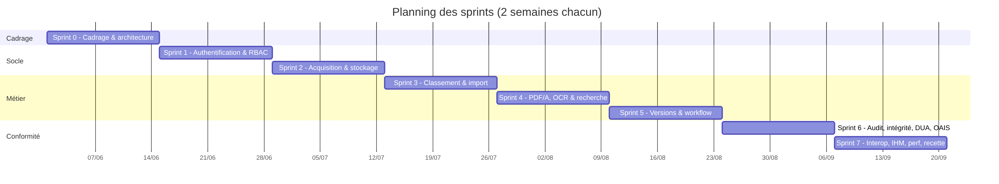

# Sprint 0 — Cadrage, architecture et socle technique

**Période** : semaines 1 et 2 · **Objectif** : transformer le cahier des charges en backlog priorisé, arrêter l'architecture et livrer un squelette exécutable.

## 1. Organisation retenue

* Méthode **Scrum** : sprints de 2 semaines, revue et rétrospective en fin de sprint, backlog estimé en points (suite de Fibonacci).
* **Définition de « terminé »** : code relu, tests automatisés verts sur SQLite **et** PostgreSQL, exigence tracée dans la matrice de conformité, documentation (rapport de sprint) à jour.
* Outils : Git + GitHub Actions (intégration continue), Docker Compose (environnements identiques du poste du développeur à la production).

## 2. Découpage du cahier des charges en épopées

| Épopée | Exigences | Sprint prévu |
|---|---|---|
| E1 — Identité, rôles, traçabilité de base | EX-03, EX-15, EX-19 (socle) | 1 |
| E2 — Acquisition et stockage sécurisé | EX-01, EX-05 (manuel), EX-07, EX-13, EX-14, EX-16 (repos) | 2 |
| E3 — Plan de classement et captures automatiques | EX-05 (lot, dossier, API), EX-08, EX-04 (messagerie) | 3 |
| E4 — Pérennisation et recherche | EX-02, EX-06, EX-09 | 4 |
| E5 — Consultation, versions, validation | EX-10, EX-11, EX-12 | 5 |
| E6 — Conformité archivistique | EX-17, EX-18, EX-19, EX-14 (contrôle) | 6 |
| E7 — Interopérabilité, IHM, performance, recette | EX-04, EX-16 (transit), EX-20 | 7 |

## 3. Livrables du sprint

* Cahier d'architecture v0.1 : choix FastAPI / PostgreSQL / MinIO / OCRmyPDF (ADR-01 à ADR-06).
* Modèle de données initial (11 tables), plan de classement de démonstration (4 séries, 7 rubriques).
* Squelette : `app/core` (configuration, base, sécurité), `docker-compose.yml`, `Makefile`, pipeline CI.
* Planning prévisionnel :

## 4. Risques identifiés

| Risque | Probabilité | Impact | Parade |
|---|---|---|---|
| Outils OCR/PDF/A absents ou mal configurés sur le serveur cible | Moyenne | Fort | Image Docker contenant toute la chaîne ; dégradation gracieuse (statut `PARTIAL`) |
| Performance de la recherche sur gros volumes | Moyenne | Moyen | Index GIN dès la V1, test de charge automatisé, service de recherche isolé (OpenSearch possible) |
| Perte de la clé de chiffrement | Faible | Critique | Clé obligatoire en production, procédure de séquestre documentée |
| Écart entre l'élimination automatique et la pratique archivistique | Moyenne | Fort | Bordereau + visa de l'archiviste par défaut, mode automatique en option |

## 5. Rétrospective

* **Positif** : la traçabilité exigence → épopée → test donne une vision claire de l'avancement.
* **À améliorer** : prévoir dès le départ un jeu de données de démonstration réaliste (fait au sprint 7, à anticiper).
