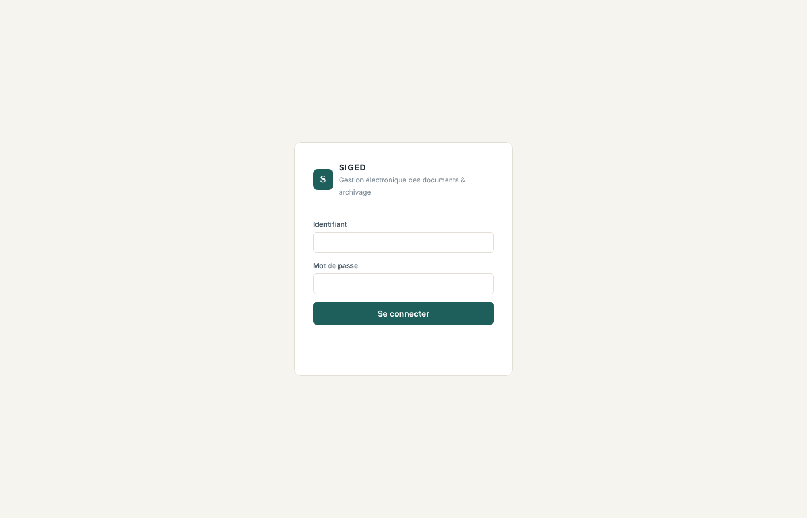

# Sprint 1 — Authentification, RBAC et socle d'audit

**Période** : semaines 3 et 4 · **Exigences** : EX-03, EX-15, EX-19 (socle)
**Vélocité** : 21 points engagés / 21 livrés

## 1. Objectif du sprint

Aucun document ne doit être accessible sans identification, chaque action doit être autorisée selon le rôle, et toute connexion doit laisser une trace.

## 2. Récits utilisateurs

| ID | En tant que… | je veux… | Points | Statut |
|---|---|---|---|---|
| US-1.1 | utilisateur | me connecter avec identifiant et mot de passe | 3 | ✔ |
| US-1.2 | RSSI | que les comptes soient verrouillés après 5 échecs | 2 | ✔ |
| US-1.3 | administrateur | créer, modifier, désactiver des comptes et leur attribuer un rôle | 3 | ✔ |
| US-1.4 | RSSI | imposer une politique de mot de passe | 1 | ✔ |
| US-1.5 | administrateur | disposer de 5 rôles avec des permissions fines | 5 | ✔ |
| US-1.6 | ERP / SIRH | m'authentifier par clé d'API révocable | 3 | ✔ |
| US-1.7 | auditeur | voir les connexions réussies et échouées dans un journal | 4 | ✔ |

## 3. Réalisation

* **Mots de passe** : bcrypt (coût 12) ; politique 10 caractères, 3 classes sur 4.
* **Jetons JWT** de 30 min ; le compte est relu à chaque requête (désactivation immédiate).
* **RBAC** : 10 permissions, 5 rôles (`admin`, `archiviste`, `validateur`, `contributeur`, `lecteur`), vérifiées par la dépendance `require(...)` sur chaque route.
* **Clés d'API** : `sged_` + 256 bits aléatoires, affichées une seule fois, stockées hachées (SHA-256), rôle `admin` interdit.
* **Journal d'audit** : premières actions tracées (`LOGIN`, `LOGIN_FAILED`, `LOGIN_LOCKED`, `USER_CREATE`, `USER_UPDATE`) avec IP et agent utilisateur.
* Rôles et administrateur initial créés automatiquement au premier démarrage.

## 4. Tests (13 tests — `tests/test_sprint1_auth_rbac.py`)

Connexion valide et invalide · verrouillage après 5 échecs (423 même avec le bon mot de passe) · rejet sans jeton ou avec un jeton forgé · politique de mot de passe · lecteur ne peut pas déposer (403) · contributeur ne peut pas gérer les comptes ni lire l'audit · compte désactivé refusé · cycle complet d'une clé d'API ERP (création, dépôt, révocation → 401) · clé d'API admin refusée · traces de connexion présentes · liste des rôles.

**Résultat : 13/13 ✔**

## 5. Démonstration

## 6. Rétrospective

* **Positif** : centraliser la vérification des droits dans une dépendance unique évite les oublis route par route.
* **Difficulté** : le validateur d'e-mails refuse les domaines réservés (`.local`) ; les comptes de démonstration utilisent un domaine réel (`.ga`).
* **Action** : ajouter dès le sprint 2 l'enregistrement de l'acteur sur toutes les opérations documentaires.
