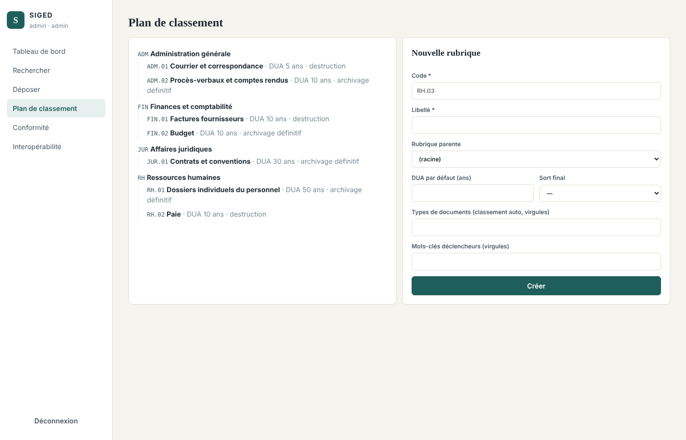

# Sprint 3 — Plan de classement, classement automatique et captures

**Période** : semaines 7 et 8 · **Exigences** : EX-05 (lot, dossier partagé, API), EX-08, EX-04 (messagerie entrante)
**Vélocité** : 29 points engagés / 29 livrés

## 1. Objectif du sprint

Organiser les documents selon une arborescence métier normée et alimenter la GED sans saisie manuelle : lots, dossier partagé, messagerie.

## 2. Récits utilisateurs

| ID | Récit | Points | Statut |
|---|---|---|---|
| US-3.1 | En tant qu'archiviste, je gère le plan de classement (rubriques, DUA et sort final par défaut) | 5 | ✔ |
| US-3.2 | En tant que contributeur, mes documents sont classés automatiquement (type, mots-clés) | 5 | ✔ |
| US-3.3 | En tant que contributeur, je peux imposer la rubrique manuellement | 1 | ✔ |
| US-3.4 | En tant que service scanné, j'importe un lot de fichiers ou un ZIP avec manifeste | 8 | ✔ |
| US-3.5 | En tant qu'opérateur, je dépose des fichiers dans un dossier partagé capté automatiquement | 5 | ✔ |
| US-3.6 | En tant que secrétariat, les pièces jointes reçues par e-mail deviennent des documents | 5 | ✔ |

## 3. Réalisation

* **Plan de classement** arborescent (`ADM`, `RH`, `FIN`, `JUR` et 7 rubriques) avec DUA et sort final par défaut ; contrôle des cycles ; suppression refusée si la rubrique contient des sous-rubriques ou des documents.
* **Classement automatique** explicable : type de document = 10 pts, mot-clé de règle trouvé dans les mots-clés ou le titre = 3 pts, dans le texte OCR = 1 pt ; normalisation sans accents ni casse. Second passage après OCR si le document n'a pas été classé au dépôt. Endpoint `POST /api/classification/suggest` pour l'aide à la saisie.
* **Import par lot** : plusieurs fichiers avec métadonnées communes, ou ZIP + `manifest.csv` (séparateur `;` ou `,`) ; réponse 207 détaillant réussites et erreurs ligne par ligne.
* **Dossier partagé (hot folder)** : fiche `.json` optionnelle à côté du fichier, valeurs par défaut `_defaults.json`, sous-dossier = code de rubrique ; délai de stabilité de 5 s (fichier en cours de copie ignoré) ; fichiers déplacés vers `_processed/` ou `_errors/` avec un `.error.txt`.
* **Messagerie** : ingestion IMAP des messages non lus ; objet → titre, expéditeur → auteur, date du message → date du document, adresse et objet en métadonnées dynamiques.

## 4. Tests (9 tests — `tests/test_sprint3_classement_import.py`)

Arborescence par défaut · classement automatique d'une facture (`FIN.01`) et d'un contrat de travail (`RH.01`) · priorité au classement manuel · suggestion pour un PV (`ADM.02`) · création, cycle refusé, suppression refusée/acceptée, droits · lot de 3 fichiers + 1 fichier vide en erreur · ZIP + manifeste avec rubriques explicite et automatique · dossier partagé (2 capturés, 1 rejeté avec cause) · e-mail avec pièce jointe PDF.

**Résultat : 9/9 ✔**

## 5. Démonstration

## 6. Rétrospective

* **Positif** : les services métier ne dépendant pas de FastAPI, le hot folder et l'ingestion e-mail réutilisent exactement la même logique que l'API (contrôles, audit, doublons).
* **Amélioration** : le score de classement est volontairement simple et explicable ; un apprentissage sur les documents déjà classés pourra l'enrichir.
