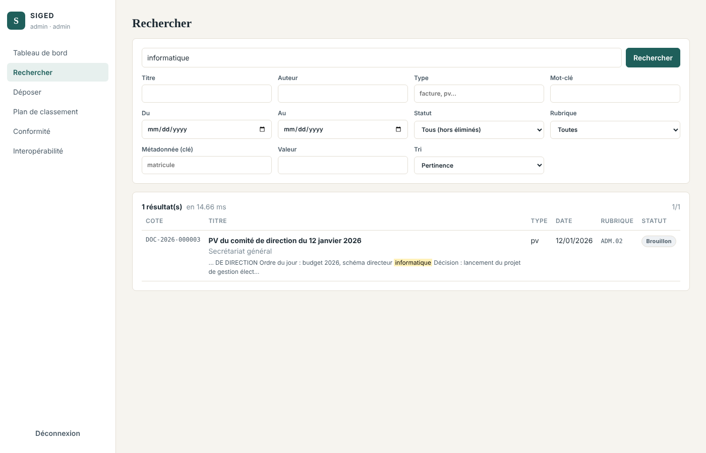

# Sprint 4 — Conversion PDF/A, OCR et moteur de recherche

**Période** : semaines 9 et 10 · **Exigences** : EX-02, EX-06, EX-09
**Vélocité** : 31 points engagés / 31 livrés

## 1. Objectif du sprint

Garantir la lisibilité à long terme (PDF/A), rendre les scans recherchables (OCR) et retrouver n'importe quel document en quelques secondes, par critères ou par son contenu.

## 2. Récits utilisateurs

| ID | Récit | Points | Statut |
|---|---|---|---|
| US-4.1 | En tant qu'archiviste, chaque document est converti en PDF/A en conservant l'original | 8 | ✔ |
| US-4.2 | En tant qu'utilisateur, je retrouve un scan par les mots qu'il contient (OCR) | 8 | ✔ |
| US-4.3 | En tant qu'utilisateur, je combine des critères (type, auteur, dates, rubrique, statut, métadonnée libre) | 5 | ✔ |
| US-4.4 | En tant qu'utilisateur, je cherche dans le texte intégral avec extrait surligné | 5 | ✔ |
| US-4.5 | En tant qu'utilisateur, les résultats sont triés par pertinence et paginés | 3 | ✔ |
| US-4.6 | En tant qu'exploitant, les conversions échouées sont relancées automatiquement | 2 | ✔ |

## 3. Réalisation

* **Chaîne de conversion** (`services/conversion.py`) exécutée en tâche de fond :

| Format d'entrée | Outil | Résultat |
|---|---|---|
| PDF (natif ou scanné) | OCRmyPDF `--output-type pdfa-2 --skip-text` | PDF/A-2b + couche OCR si nécessaire |
| Image (PNG, JPEG, TIFF…) | OCRmyPDF (`--image-dpi 300`) ; à défaut Tesseract | PDF/A-2b recherchable |
| Bureautique (DOCX, ODT, XLSX, PPTX, RTF…) | LibreOffice headless, filtre PDF/A-2 | PDF/A-2b |
| Texte | lecture directe + LibreOffice | PDF/A-2b |

* L'original est **toujours conservé** ; la représentation PDF/A a sa propre empreinte SHA-256. Statuts : `DONE`, `PARTIAL` (texte extrait sans PDF/A), `FAILED`, `SKIPPED`, avec journal de conversion.
* **Recherche** (`services/search.py`) : 13 critères combinables, tri (pertinence, date, titre), pagination ; inclusion des sous-rubriques lors d'un filtre par rubrique ; documents éliminés exclus par défaut.
* **PostgreSQL** : `websearch_to_tsquery('french', …)` (syntaxe type moteur web : guillemets, `-exclusion`, `or`), index GIN, classement `ts_rank` + similarité trigramme du titre, extraits `ts_headline` surlignés. **SQLite** (développement) : repli `LIKE`.
* Chaque recherche avec critères est tracée (`SEARCH`).

## 4. Tests (9 tests — `tests/test_sprint4_conversion_recherche.py`)

Extraction du texte d'un PDF · recherche plein texte avec extrait surligné · combinaisons de critères (type, auteur, période, mot-clé accentué, tri) · filtre par rubrique incluant les sous-rubriques · métadonnée dynamique (matricule) · pagination · **conversion réelle PDF → PDF/A-2b** · **OCR réel d'une image → PDF/A-2b, puis retrouvée par son contenu** · **DOCX → PDF/A-2b via LibreOffice**, retrouvé par un mot accentué.

**Résultat : 9/9 ✔** (les 3 tests de conversion utilisent les vrais outils OCRmyPDF, Tesseract, Ghostscript, LibreOffice)

## 5. Démonstration

## 6. Rétrospective

* **Difficulté** : sans Ghostscript, OCRmyPDF ne produit ni PDF/A ni PDF ; la chaîne bascule alors sur Tesseract et marque la version `PARTIAL`. Ghostscript et les données OCR françaises sont inclus dans l'image Docker.
* **Difficulté** : les mots-clés stockés en JSON étaient échappés (`é`) et la recherche de « réunion » échouait sous SQLite ; corrigé en sérialisant le JSON sans échappement ASCII.
* **Mesure** : sur 2 000 notices, recherche plein texte en 0,44 s sous PostgreSQL (objectif < 2 s tenu).
