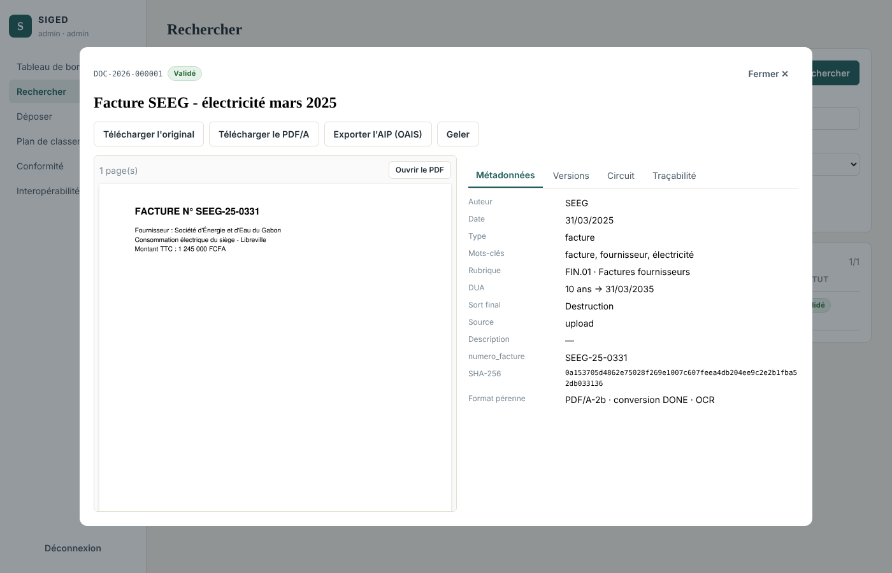
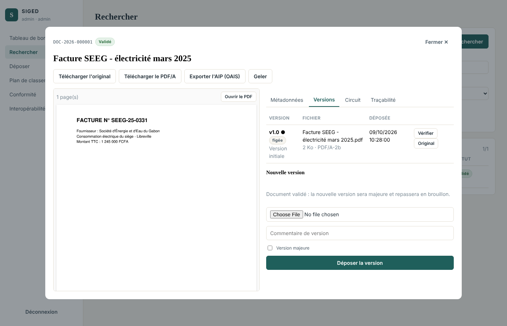
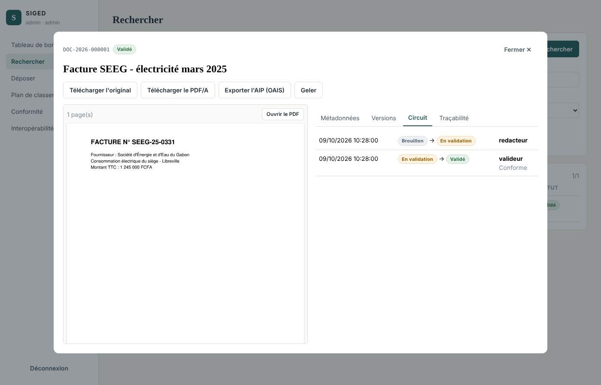

# Sprint 5 — Prévisualisation, versions et circuit de validation

**Période** : semaines 11 et 12 · **Exigences** : EX-10, EX-11, EX-12
**Vélocité** : 28 points engagés / 28 livrés

## 1. Objectif du sprint

Consulter un document sans le télécharger, suivre ses révisions sans perdre l'historique et le faire approuver selon un circuit contrôlé.

## 2. Récits utilisateurs

| ID | Récit | Points | Statut |
|---|---|---|---|
| US-5.1 | En tant qu'utilisateur, je visualise le document dans le navigateur, y compris sur mobile | 5 | ✔ |
| US-5.2 | En tant que contributeur, je dépose une nouvelle version mineure (1.1) ou majeure (2.0) | 5 | ✔ |
| US-5.3 | En tant qu'utilisateur, je consulte et télécharge n'importe quelle version antérieure | 2 | ✔ |
| US-5.4 | En tant que contributeur, je soumets mon document à validation | 3 | ✔ |
| US-5.5 | En tant que valideur, j'approuve ou je rejette avec un motif | 5 | ✔ |
| US-5.6 | En tant que responsable qualité, un document validé est figé | 3 | ✔ |
| US-5.7 | En tant que SIRH, je suis notifié par webhook quand un document est validé | 5 | ✔ |

## 3. Réalisation

* **Aperçu** : les pages sont rendues côté serveur en images PNG (`/preview/pages`, `/preview/page/{n}`) à partir du PDF/A. Cette approche fonctionne sur tous les navigateurs, y compris Chrome Android qui n'affiche pas les PDF intégrés. Un bouton « Ouvrir le PDF » propose le flux PDF inline (`Content-Disposition: inline`, `no-store`).
* **Versions** : numérotation majeure/mineure, une seule version courante, historique jamais écrasé (contrainte d'unicité `(document, majeure, mineure)`), dépôt identique à la version courante refusé.
* **Machine à états** : `DRAFT → PENDING_VALIDATION → VALIDATED`, rejet vers `DRAFT` avec motif obligatoire ; transitions invalides → 409 ; historique dans `workflow_events`.
* **Règles de gestion** :
  * séparation des tâches : l'auteur ne peut pas valider son propre document (sauf administrateur) ;
  * aucune nouvelle version pendant la validation ;
  * un document validé a ses métadonnées figées ; une nouvelle version force la version majeure suivante et le repasse en brouillon, la version validée restant figée et consultable.
* **Notifications** : webhooks signés HMAC-SHA256 ; e-mail aux valideurs lors d'une soumission et à l'auteur lors d'une décision (si SMTP configuré).

## 4. Tests (11 tests — `tests/test_sprint5_versions_workflow.py`)

Aperçu inline identique à l'original déchiffré · aperçu en images PNG (page inexistante → 404) · téléchargement de l'original · versions 1.0 → 1.1 → 2.0 avec historique intact et v1.0 retéléchargeable à l'octet près · version identique refusée · circuit complet (soumission, tentative d'approbation sans droit, version interdite pendant la validation, rejet sans motif refusé, rejet, re-soumission, approbation, historique) · document validé figé puis réouvert en v2.0 · validateur sans droit d'écriture · auto-validation refusée · modification tracée avec ancienne et nouvelle valeur · webhook émis avec signature HMAC vérifiée.

**Résultat : 11/11 ✔**

## 5. Démonstration

## 6. Rétrospective

* **Difficulté** : l'aperçu PDF par `<iframe>` restait vide dans certains navigateurs (Chromium sans visionneuse, mobiles) ; passage au rendu des pages en images côté serveur (pypdfium2), plus universel.
* **À prévoir** : mettre en cache les pages rendues pour les documents très consultés.
