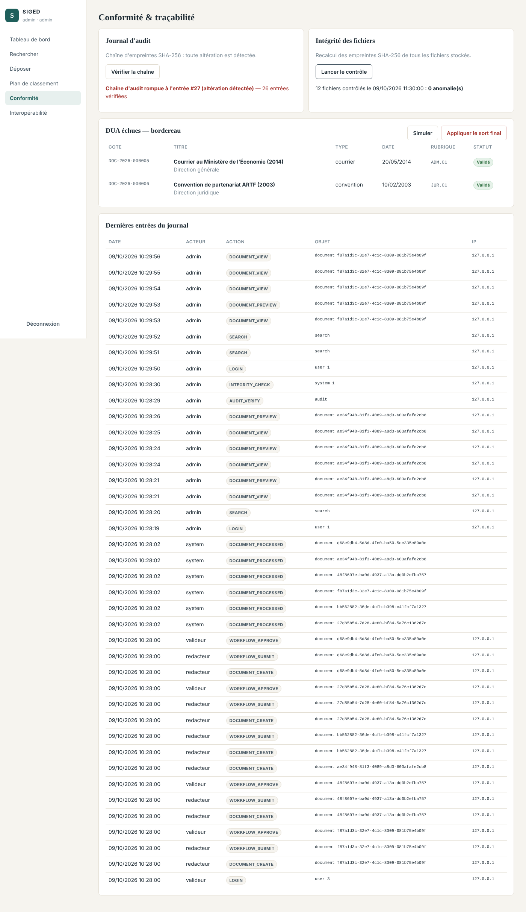
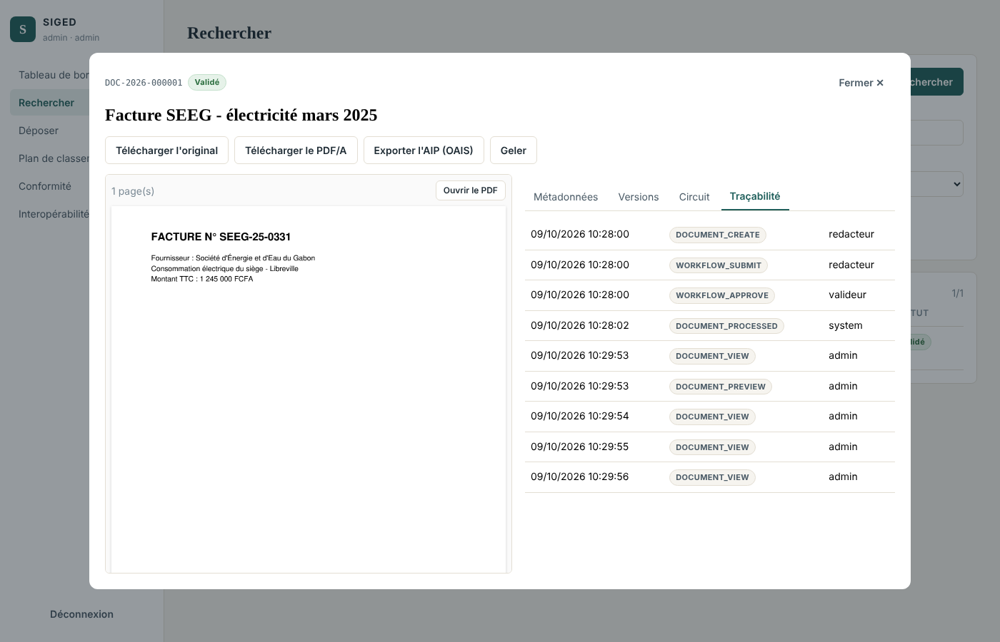

# Sprint 6 — Conformité : audit inaltérable, intégrité, DUA, OAIS

**Période** : semaines 13 et 14 · **Exigences** : EX-14 (contrôle), EX-17, EX-18, EX-19
**Vélocité** : 34 points engagés / 34 livrés

## 1. Objectif du sprint

Rendre la plateforme opposable : preuve que rien n'a été altéré, application maîtrisée des durées de conservation, export normalisé vers un service d'archives.

## 2. Récits utilisateurs

| ID | Récit | Points | Statut |
|---|---|---|---|
| US-6.1 | En tant qu'auditeur, toute consultation, modification et suppression est tracée | 5 | ✔ |
| US-6.2 | En tant qu'auditeur, je peux prouver que le journal n'a pas été modifié | 8 | ✔ |
| US-6.3 | En tant qu'archiviste, les fichiers sont contrôlés chaque nuit et toute altération est signalée | 5 | ✔ |
| US-6.4 | En tant qu'archiviste, j'obtiens le bordereau des DUA échues et j'applique le sort final | 8 | ✔ |
| US-6.5 | En tant que juriste, je gèle un document en contentieux pour empêcher son élimination | 2 | ✔ |
| US-6.6 | En tant qu'archiviste, j'exporte un paquet d'archives OAIS (AIP) | 5 | ✔ |
| US-6.7 | En tant qu'administrateur, je supprime un brouillon déposé par erreur, avec motif | 1 | ✔ |

## 3. Réalisation

* **Journal chaîné** : `entry_hash = SHA-256(prev_hash, horodatage, acteur, action, objet, détails)` ; `GET /api/audit/verify` recalcule la chaîne et indique la première entrée rompue.
* **Inaltérabilité PostgreSQL** : déclencheurs bloquant `UPDATE`, `DELETE`, `TRUNCATE` sur `audit_logs`.
* **Écritures concurrentes** : verrou consultatif transactionnel `pg_advisory_xact_lock` (PostgreSQL) ou verrou de processus maintenu jusqu'à la fin de la transaction (SQLite) — voir rétrospective.
* **Actions tracées** : création, consultation de fiche, aperçu, téléchargement, recherche, modification (avant/après), versions, transitions de workflow, gel, export AIP, élimination, versement, contrôle d'intégrité, administration des comptes, clés et webhooks.
* **Contrôle d'intégrité** : relecture et déchiffrement de chaque objet (original et PDF/A), comparaison des empreintes ; anomalies enregistrées (`integrity_checks`), tracées (`INTEGRITY_FAILURE`) et notifiées (webhook `integrity.failure`) ; vérification unitaire par version.
* **DUA** : `retention_until` stocké et indexé ; bordereau (`/retention/due`), échéancier (`/retention/upcoming`), exécution simulée ou réelle (`/retention/run`) ; élimination physique avec certificat (empreintes détruites) ; versement définitif ; gel juridique.
* **AIP OAIS** : ZIP au format BagIt (manifeste SHA-256, toutes les versions, `description.json`, `pdi.json` avec provenance issue du journal).

## 4. Tests (13 tests — `tests/test_sprint6_conformite.py`)

Chaîne valide · altération d'une ligne détectée à l'entrée exacte (SQLite) · `UPDATE`/`DELETE` refusés par PostgreSQL · consultation, aperçu et téléchargement tracés · altération d'un octet d'un fichier stocké détectée par le contrôle global et par la vérification unitaire · bordereau (seuls les documents validés échus) et simulation sans effet · élimination : fichiers physiquement supprimés, notice et trace conservées, exclusion de la recherche · versement définitif puis modification refusée · gel excluant du bordereau · DUA au 29 février · AIP : contenu, manifeste vérifié fichier par fichier, provenance · suppression limitée aux brouillons, motif obligatoire · **80 écritures d'audit concurrentes sans rupture de chaîne**.

**Résultat : 12 ✔ + 1 test propre à l'autre SGBD ignoré par exécution** (le test d'altération directe s'exécute sous SQLite, le test des déclencheurs sous PostgreSQL ; les deux sont verts dans la CI).

## 5. Démonstration

## 6. Rétrospective

* **Anomalie trouvée en démonstration** : la vérification du journal a signalé une rupture. Cause : plusieurs conversions en tâche de fond écrivaient en même temps et lisaient la même « dernière empreinte », ce qui créait une bifurcation de la chaîne. Correction : sérialisation des écritures jusqu'à la fin de la transaction, et test de non-régression avec 8 fils et 80 écritures. Cet incident montre l'intérêt du chaînage : une incohérence invisible autrement a été détectée immédiatement.
* **Difficulté** : le script SQL PostgreSQL contient des `%` (PL/pgSQL) interprétés comme paramètres par le pilote ; exécution directe sur la connexion brute.
