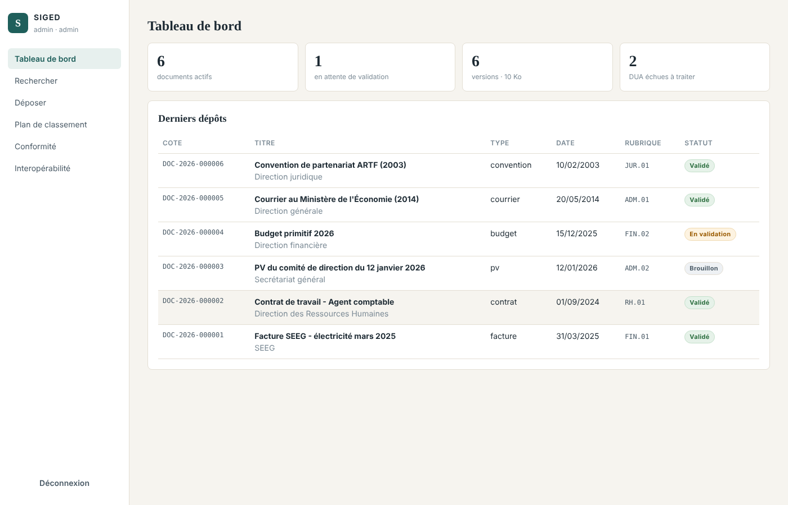
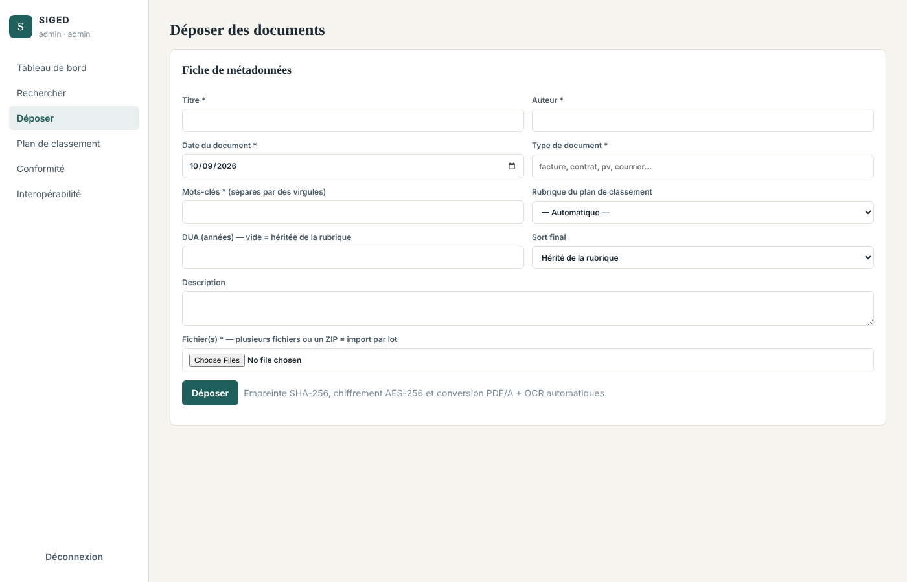
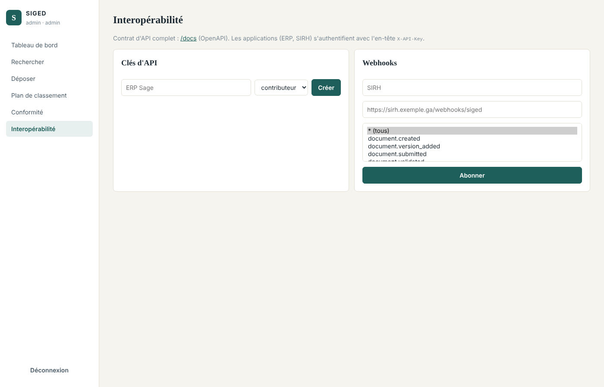
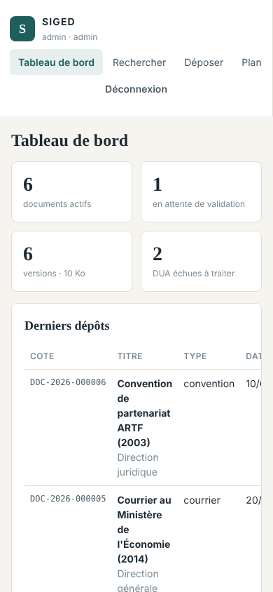

# Sprint 7 — Interopérabilité, interface web, performance et recette

**Période** : semaines 15 et 16 · **Exigences** : EX-04, EX-16 (transit), EX-20, recette globale
**Vélocité** : 30 points engagés / 30 livrés

## 1. Objectif du sprint

Livrer une application utilisable de bout en bout, connectable au système d'information, mesurée et déployable.

## 2. Récits utilisateurs

| ID | Récit | Points | Statut |
|---|---|---|---|
| US-7.1 | En tant qu'utilisateur, je dispose d'une interface web complète, utilisable sur mobile | 8 | ✔ |
| US-7.2 | En tant qu'administrateur, je gère clés d'API et webhooks depuis l'interface | 3 | ✔ |
| US-7.3 | En tant que DSI, je dispose d'un contrat d'API OpenAPI | 1 | ✔ |
| US-7.4 | En tant qu'exploitant, je déploie toute la solution en une commande, en TLS 1.3 | 5 | ✔ |
| US-7.5 | En tant qu'exploitant, je supervise la santé et les temps de réponse | 3 | ✔ |
| US-7.6 | En tant qu'exploitant, les sauvegardes sont quotidiennes et restaurables | 5 | ✔ |
| US-7.7 | En tant que chef de projet, je vérifie la tenue des 2 s sur un volume représentatif | 3 | ✔ |
| US-7.8 | En tant que formateur, je dispose d'un jeu de données de démonstration | 2 | ✔ |

## 3. Réalisation

* **Interface web** (JavaScript natif, sans dépendance externe, adaptée au mobile) : tableau de bord, recherche multicritère avec extraits surlignés, dépôt unitaire ou par lot, fiche document (aperçu, métadonnées, versions, circuit, traçabilité), plan de classement, conformité (vérification du journal, intégrité, bordereau DUA), interopérabilité. Les menus et actions dépendent des permissions ; tout contenu est échappé (protection XSS).
* **Déploiement** : `docker-compose.yml` (Nginx, API, worker, PostgreSQL, MinIO, sauvegarde) ; image incluant Tesseract (fra/eng), Ghostscript, LibreOffice ; utilisateur non root ; sonde de santé.
* **TLS 1.3** exclusif, HSTS, CSP, limitation de débit sur la connexion ; script de certificat de test.
* **Supervision** : `/health` (base + stockage, 503 si dégradé), en-tête `X-Process-Time-ms` sur chaque réponse, journalisation des requêtes de plus de 2 s, indicateurs `/api/admin/stats`.
* **Sauvegardes** : dump PostgreSQL + objets chiffrés chaque nuit, `SHA256SUMS`, rétention 30 jours, script de restauration avec vérification.
* **CI** : GitHub Actions exécute toute la suite sur SQLite et PostgreSQL avec les vrais outils OCR.
* **Jeu de démonstration** : `python -m scripts.demo_data` crée 4 comptes (un par rôle) et 6 documents réalistes à différents stades.

## 4. Tests (6 tests — `tests/test_sprint7_perf_interop.py`) et mesures

Sonde de santé · en-têtes de performance et de sécurité · interface servie · contrat OpenAPI exposant les routes clés · indicateurs du tableau de bord · **test de charge : 2 000 notices, 4 types de recherche < 2 s**.

| Recherche (2 000 notices) | SQLite | PostgreSQL 16 |
|---|---|---|
| Plein texte « convention » (200 résultats) | 66 ms | 442 ms |
| Type + date | 13 ms | 17 ms |
| Auteur + tri | 23 ms | 41 ms |
| Liste sans critère | 23 ms | 33 ms |

PostgreSQL est plus lent en plein texte car il calcule la racinisation, le classement et les extraits surlignés que SQLite ne fait pas ; il reste 4,5 fois sous l'objectif.

**Résultat : 6/6 ✔**

## 5. Démonstration

## 6. Rétrospective

* **Positif** : la recette sur données réalistes a révélé deux défauts (bifurcation du journal, aperçu PDF) corrigés avant livraison.
* **Dette technique identifiée** : migrations Alembic, cache des aperçus, colonne `tsvector` stockée pour accélérer le classement plein texte, test de charge en conditions de production (plusieurs centaines de milliers de documents).
